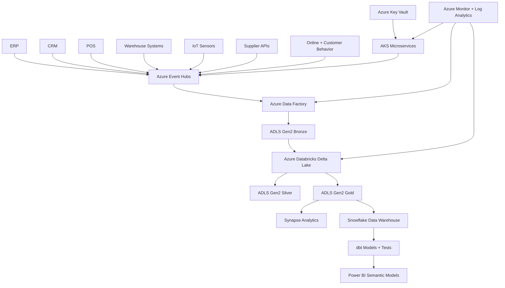

# Enterprise Global Retail Data Platform On Azure

Cloud-native deployment scaffold for a multinational retail data platform processing POS transactions, online orders, inventory, supply chain, warehouse, delivery, customer behavior, product catalog, marketing, and IoT warehouse sensor events.

The repository is built for real environment deployment, but it does not claim a live Azure/Snowflake/Databricks/Informatica deployment has happened from this workstation. Account-specific IDs, remote state, secrets, network ranges, and service principals must be supplied by the target organization.

## Architecture



## What Is Included

- Azure Terraform for resource group, ADLS Gen2, Event Hubs, Data Factory, Databricks, Synapse, Snowflake-ready exports, AKS, ACR, Key Vault, Log Analytics, managed identities, diagnostics, and RBAC.
- Python data contracts, validation, Bronze/Silver/Gold transforms, a FastAPI ingestion health surface, and a stream processor entrypoint.
- Dockerfiles with non-root users, health checks, pinned slim Debian base images, and compact build context.
- Kubernetes base and environment overlays for AKS.
- Databricks Asset Bundle notebooks for Bronze to Silver and Silver to Gold Delta jobs.
- Snowflake bootstrap SQL and dbt models/tests for retail analytics marts.
- Informatica workflow metadata for enterprise ETL orchestration handoff.
- GitHub Actions CI and gated deploy workflow using Azure OIDC.
- PowerShell scripts for Windows-compatible local validation and deployment.

## Real Deployment Prerequisites

- Azure subscription with permission to create resource groups, AKS, ACR, Event Hubs, ADLS, Data Factory, Databricks, Synapse, Key Vault, role assignments, and diagnostic settings.
- Microsoft Entra ID group object IDs for AKS admins and deployment operators.
- Remote Terraform backend storage account and container, created by your platform team.
- GitHub environment secrets or variables for Azure OIDC: `AZURE_CLIENT_ID`, `AZURE_TENANT_ID`, `AZURE_SUBSCRIPTION_ID`.
- Snowflake account, database admin role, storage integration for Azure Blob, and dbt service user.
- Databricks workspace permissions and Unity Catalog/storage credentials if enabled in your tenant.
- Informatica secure agent and connection names matching `informatica/retail_enterprise_etl.yaml`.

## Local Validation

From Windows PowerShell:

```powershell
.\scripts\validate-local.ps1
```

The script runs Python compile/tests, Ruff when installed, Terraform format/validate when Terraform is installed, and Kubernetes rendering when `kubectl` is installed. It does not call Azure, Snowflake, Databricks, or Informatica APIs without credentials.

## Deployment Flow

1. Copy one of the environment tfvars examples and fill real IDs:

```powershell
copy infra\terraform\environments\dev\terraform.tfvars.example infra\terraform\environments\dev\terraform.tfvars
notepad infra\terraform\environments\dev\terraform.tfvars
```

2. Authenticate with Azure CLI or GitHub OIDC.

3. Apply infrastructure:

```powershell
.\scripts\deploy-azure.ps1 -Environment dev -TerraformVarFile infra\terraform\environments\dev\terraform.tfvars
```

4. Push images to ACR and deploy AKS workloads through the GitHub Actions deployment workflow or the same script after infrastructure outputs are available.

5. Configure Snowflake external stages with values from Terraform outputs and run:

```powershell
snowsql -f snowflake\sql\bootstrap.sql
cd dbt
python -m pip install -r ..\requirements-dbt.txt
dbt parse
dbt test
```

## Accuracy Boundary

Local validation can prove syntax, unit logic, rendering, and buildability. It cannot prove live cloud deployment, private networking, DNS, Azure RBAC propagation, Databricks cluster execution, Snowflake external stage access, Power BI refresh, or Informatica runtime execution. Those checks require real tenant credentials and target environment approvals.
