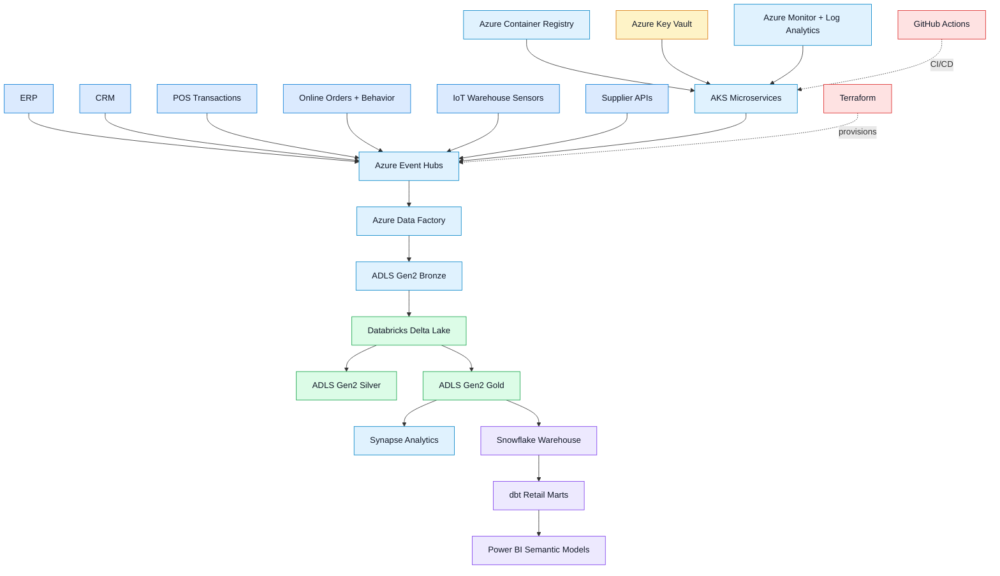

<div align="center">


### Cloud-native multinational retail data platform for POS, e-commerce, inventory, supply chain, customer behavior, IoT warehouse events, and executive analytics.


</div>

---

## Project Overview

**Enterprise Global Retail Data Platform On Azure** is a production-style data engineering platform for global retail analytics. It processes POS transactions, online orders, inventory, supplier feeds, warehouse events, delivery updates, product catalog data, marketing activity, customer behavior, and IoT warehouse sensor events.

The project demonstrates a complete Azure retail lakehouse architecture using **Event Hubs, Azure Data Factory, ADLS Gen2, Databricks Delta Lake, Synapse, Snowflake, dbt, AKS, Terraform, GitHub Actions, Key Vault, Log Analytics, and Informatica handoff assets**.

---

## Retail Use Cases

| Domain       | Analytics Supported                                  |
| ------------ | ---------------------------------------------------- |
| Sales        | POS transactions, online orders, store revenue       |
| Inventory    | Stock movement, product availability, replenishment  |
| Customer     | Behavior tracking, segmentation, customer 360        |
| Supply Chain | Supplier feeds, delivery tracking, warehouse events  |
| Marketing    | Campaign performance and conversion analytics        |
| Operations   | Power BI dashboards, Snowflake marts, executive KPIs |

---

## Architecture



---

## What This Repository Includes

| Layer          | Implementation                                               |
| -------------- | ------------------------------------------------------------ |
| Infrastructure | Terraform for Azure platform resources                       |
| Storage        | ADLS Gen2 bronze, silver, and gold lakehouse zones           |
| Streaming      | Event Hubs for POS, CRM, ERP, web, warehouse, and IoT events |
| Orchestration  | Azure Data Factory for batch and scheduled ingestion         |
| Processing     | Databricks Delta Lake with medallion transformations         |
| Warehouse      | Snowflake bootstrap SQL and dbt retail marts                 |
| Serving        | Synapse Analytics and Power BI-ready semantic models         |
| Runtime        | AKS microservices, Docker, Azure Container Registry          |
| Security       | Key Vault, managed identities, RBAC, diagnostics             |
| DevOps         | GitHub Actions CI/CD with Azure OIDC                         |

---

## Medallion Data Flow

```text
Retail Sources
  -> Azure Event Hubs / Azure Data Factory
  -> ADLS Gen2 Bronze
  -> Databricks Delta Lake
  -> ADLS Gen2 Silver
  -> ADLS Gen2 Gold
  -> Synapse / Snowflake / dbt
  -> Power BI and Executive Analytics
```

---

## Local Validation

```powershell
.\scripts\validate-local.ps1
```

Validation checks Python compilation, tests, Ruff when available, Terraform formatting/validation, and Kubernetes rendering when `kubectl` is installed.

---

## Deployment Flow

```powershell
copy infra\terraform\environments\dev\terraform.tfvars.example infra\terraform\environments\dev\terraform.tfvars
notepad infra\terraform\environments\dev\terraform.tfvars
.\scripts\deploy-azure.ps1 -Environment dev -TerraformVarFile infra\terraform\environments\dev\terraform.tfvars
```

Then configure Snowflake and dbt:

```powershell
snowsql -f snowflake\sql\bootstrap.sql
cd dbt
python -m pip install -r ..\requirements-dbt.txt
dbt parse
dbt test
```

---

## Security Notes

* No real secrets should be committed
* Use Azure Key Vault for runtime secrets
* Use GitHub OIDC for Azure authentication
* Use managed identities and least-privilege RBAC
* Use separate dev, stage, and prod environment values
* Provide real Azure, Databricks, Snowflake, and Informatica values before live deployment

---

## Author

**Sujoy Halder**
Azure | Data Engineering | Databricks | Snowflake | dbt | AKS | Terraform | Retail Analytics | CI/CD

GitHub: [sujoy-halder](https://github.com/sujoy-halder)

<div align="center">


</div>
